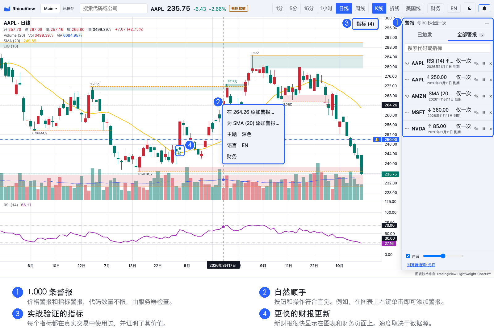
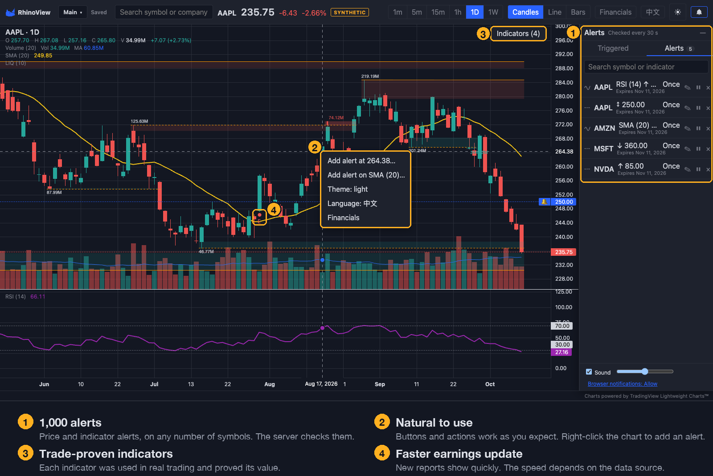

<p align="center">
  
</p>

<h1 align="center">RhinoView</h1>

<p align="center"><a href="README.md">English</a> · <b>简体中文</b></p>



**新用户？请阅读[用户指南](docs/USER_GUIDE.zh-CN.md)。**

RhinoView 是一款金融图表应用。客户端使用 React、TypeScript 和
[Lightweight Charts](https://github.com/tradingview/lightweight-charts)。一个轻量的 Fastify
代理服务保管 API 密钥，并对上游数据进行规范化处理。

## 功能

- 代码搜索，以及 K 线图、折线图和美国线（OHLC 柱状图）。
- 六个周期：1 分钟、5 分钟、15 分钟、1 小时、日线和周线。具体提供哪些周期由数据源决定。
- 双向平移和缩放；向左滚动时按需加载更早的历史数据。
- 十字光标处显示开、高、低、收和成交量。
- SMA、EMA、RSI 和 MACD 指标，各副图与主图同步。
- 主图上的成交量、可见区间成交量分布（VRVP），以及流动性区域与扫单（Liquidity）。
- 图表上的财报标记（中文界面显示“财”，英文界面显示 “E”）。
- 命名布局。每个布局保存一张图表：代码、周期、图表类型和指标。
- 自选列表：可建立多个命名列表，支持排序、拖动调整顺序和报价。侧边栏宽度可以调整。
- 使用模拟数据时，顶部报价和自选列表显示“模拟数据”标记，避免被误认为真实行情。
- 财务页面：概览、财务报表、趋势和财报。
- 深色主题和浅色主题。
- 英文界面和简体中文界面。详见[语言](#语言)。
- 图表菜单：在图表上右键单击，或按 Shift+F10。可以添加警报，也可以切换主题和语言。
- 价格警报和指标警报（SMA、EMA、RSI、MACD），最多 1000 条，代码数量不限。
  由服务器检查。警报触发时弹出提示并播放提示音，铃铛按钮保存触发记录。

代理服务把布局和自选列表保存在服务器上的一个 JSON 文件中（`WORKSPACE_FILE`），
把警报及其触发记录保存在另一个文件中（`ALERTS_FILE`）。

## 语言

首次访问时使用浏览器的语言：浏览器语言为 `zh` 时显示中文，其他情况显示英文。工具栏中的
**中文 / EN** 按钮用于切换语言。浏览器会记住您的选择（`localStorage`，键名
`rhinoview:locale`）。

中文界面不只是翻译文字：

- 按照中国市场的习惯，上涨为红色，下跌为绿色。英文界面仍然是绿涨红跌。
- 大数字使用“万”和“亿”，例如 4676.81万、1.26亿。
- 时间轴使用中文日期，例如“6月”“11日”。
- 财报期显示为“2026财年”“2026财年Q1”。
- MA、EMA、RSI、MACD、VRVP 等通用缩写保持不变。

来自数据源的数据不做翻译：公司名称、简介和板块保持数据源原有的语言。部分错误信息由服务器
返回，仍为英文。



## 数据源

环境变量 `DATA_PROVIDER` 用于选择数据源：

| 数据源 | 密钥 | 行情数据 | 财务数据 |
|---|---|---|---|
| `synthetic`（默认） | 不需要 | 全部六个周期。数据为程序生成，结果固定，适合开发和测试。 | 生成的数据 |
| `fmp` | `FMP_API_KEY` | 见下表。 | 来自 FMP 的真实数据 |
| `massive` | `MASSIVE_API_KEY` | 尚未实现 | 不提供 |

`fmp` 数据源能提供哪些周期，取决于您的 FMP 套餐：

| FMP 套餐 | 周期 |
|---|---|
| Free | 仅日线和周线。所有日内接口都返回 HTTP 402。 |
| Starter | 5 分钟、15 分钟、1 小时、日线和周线。1 分钟接口返回 HTTP 402，因此 RhinoView 不提供 1 分钟周期。 |

`GET /api/capabilities` 会返回当前数据源支持的内容。

FMP 数据有一些已知问题，`server/market/fmp/engine.ts` 和 `server/fundamentals/types.ts`
的文件头注释对此有说明。例如，FMP 有时会返回带小数的日内成交量，代理服务会将其取整为整股。

## 安装与运行

```bash
npm install
cp .env.example .env
npm run dev
```

代理服务监听 8787 端口，Vite 监听 5173 端口。

默认数据源是 `synthetic`，不需要任何密钥。要使用真实数据，请按以下步骤操作：

1. 在 `.env` 中把您的 FMP 密钥填入 `FMP_API_KEY`。
2. 在 `.env` 中设置 `DATA_PROVIDER=fmp`。
3. 确认 `.env` 中有 `VITE_USE_MOCKS=false`（示例文件中已是此值）。如果该值不是 `false`，
   浏览器会使用 MSW 模拟数据。

**不要提交 `.env` 文件，也不要给密钥加上 `VITE_` 前缀。** Vite 会把所有 `VITE_` 开头的变量
打包进浏览器代码。只有 `server/env.ts` 会读取密钥，密钥永远不会发送到浏览器。客户端只调用
同源的 `/api/*`；开发时由 Vite 把这些请求转发给代理服务。

## 常用命令

| 命令 | 作用 |
|---|---|
| `npm run dev` | 同时启动代理服务和 Vite 开发服务器 |
| `npm run typecheck` | 对 `shared/`、`server/` 和 `src/` 运行 `tsc --noEmit` |
| `npm run lint` | 运行 eslint |
| `npm test` | 运行 vitest：`client` 项目（jsdom）和 `node` 项目 |
| `npm run build` | 先做类型检查，再生成生产环境代码包 |

FMP 在线测试默认跳过。要运行这些测试，请使用下面的命令。它会向 FMP 发送大约九个请求。

```bash
FMP_LIVE=1 npx vitest run --project node server/market/fmp/live
```

## 目录结构

```
shared/            客户端与代理服务共用的接口类型，是唯一的事实来源
server/market/     行情数据引擎：synthetic 和 FMP
server/fundamentals/ 财务数据源：synthetic 和 FMP
server/workspace/  布局和自选列表的 JSON 存储
server/routes/     HTTP 路由
server/provider/   缓存、错误、报价和故障注入
src/chart/         lightweight-charts 封装、副图、标记和纵向平移
src/data/          基于代理接口约定的 DataSource 接口
src/indicators/    纯函数指标计算：SMA、EMA、RSI、MACD、成交量、VRVP 和流动性
src/panes/         指标副图界面
src/workspace/     当前布局的客户端状态
src/layouts/       布局切换器
src/watchlist/     自选列表侧边栏
src/fundamentals/  财务页面
src/ui/            代码搜索、周期选择、图例、侧边栏宽度调整和标志
src/i18n/          中英文文案、语言切换和数字格式
mocks/             MSW 处理程序，以及从真实上游响应录制的测试数据
```

## 文档

- [`docs/USER_GUIDE.zh-CN.md`](docs/USER_GUIDE.zh-CN.md)：用户指南：右键菜单、指标、警报、调用预算和通知。

以下文档目前只有英文版：

- [`AGENTS.md`](AGENTS.md)：给 AI 代理的说明，以及 ASD-STE100 输出风格。
- [`docs/MULTIAGENT_PLAN.md`](docs/MULTIAGENT_PLAN.md)：构建计划、阶段和评审关口。
- [`docs/CONTRACT.md`](docs/CONTRACT.md)：客户端与代理服务之间的 HTTP 接口约定。
- [`docs/AGENT_BRIEF.md`](docs/AGENT_BRIEF.md)：共享背景、文件归属和已知陷阱。
- [`docs/PHASE5_PLAN.md`](docs/PHASE5_PLAN.md)：自选列表、布局和财务功能的计划。
- [`docs/PHASE5_REPORT.md`](docs/PHASE5_REPORT.md)：第 5 阶段报告。
- [`docs/LIQUIDITY_PLAN.md`](docs/LIQUIDITY_PLAN.md)：流动性指标的规格说明。
- [`docs/ALERTS_PLAN.md`](docs/ALERTS_PLAN.md)：图表菜单和警报的规格说明。

## 致谢与许可

RhinoView 使用 TradingView Lightweight Charts™ 绘制图表。图表库自带的图上标志已关闭（指
TradingView 的标志，不是 RhinoView 的犀牛标志）。应用页脚中的致谢链接满足其许可证的链接
要求。修改 TradingView 标志设置或致谢链接之前，请先阅读 [NOTICE](NOTICE)。

## 暂不包含

RhinoView 目前没有实时 WebSocket 推送，也没有画线工具。数据层位于 `DataSource` 接口之后，
因此以后可以加入实时推送，而无需修改界面组件。
